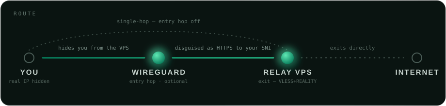

<p align="center">
  
</p>

<h1 align="center">vpn-chain</h1>
<p align="center">
  A censorship-resistant VPN you run on your own server, for Android and Linux.
</p>

<p align="center">
  
</p>

`you → WireGuard entry hop (optional) → your VPS → internet`

Your traffic leaves from your own VPS and looks like ordinary HTTPS on the way
there. With the entry hop on, your network sees only a WireGuard connection to
your VPN provider, and the VPS never sees your real address.

## Setup

You need a Debian or Ubuntu VPS with TCP port 443 open. If you sign in to it with
an SSH key, add the key first: setup then turns off password sign-in. Port 22
stays open either way.

1. On the VPS, run:

   ```
   curl -fsSL https://github.com/Verdenroz/vpn-chain/releases/latest/download/setup.sh | sudo bash
   ```

   It checks that the download is ours, sets up your relay, and prints a QR code
   and a link. They work once, for 24 hours. If they run out, run the same command
   again: it prints a new code until the first device is set up. If you ever lose
   every device that manages the relay, `sudo relayd pair` on the VPS prints a code
   for the first one again.

2. Install the app.
   - **Linux (x64, Debian or Ubuntu):** download `vpn-chain_<version>_amd64.deb` from the
     [latest release](https://github.com/Verdenroz/vpn-chain/releases/latest) and install it:

     ```
     sudo apt install ./vpn-chain_<version>_amd64.deb
     ```

     Open **VPN Chain** from your app menu. The package includes the tunnel and the
     kill switch, so there is nothing else to install. New releases install from
     inside the app and ask for your password once.

   - **Linux (x64, Arch):** download `vpn-chain-<version>-1-x86_64.pkg.tar.zst` from the
     [latest release](https://github.com/Verdenroz/vpn-chain/releases/latest) and install it:

     ```
     sudo pacman -U vpn-chain-<version>-1-x86_64.pkg.tar.zst
     ```

     Same app, tunnel and kill switch as the `.deb`, and new releases install from
     inside the app the same way.

   - **Android:** download `vpn-chain-<version>-android-arm64-v8a.apk` from the
     [latest release](https://github.com/Verdenroz/vpn-chain/releases/latest)
     and install it.

3. Open the app and scan the QR code, or paste the link (on Linux, paste). The app
   connects and makes this device the admin of your relay. The code stops working
   once it is used, so a photo of it is no use to anyone.

4. Optional entry hop: create a WireGuard config at your VPN provider for this
   device alone, paste the `.conf` in **Settings → Connection → Import**, then tap
   **Use as entry hop**.

To exit through a WireGuard provider instead of the VPS's own address, open
**Settings → Devices → Exit** in the app, tap **Use a WireGuard exit**, and paste the
`.conf` your provider gave you. The relay restarts, so everyone drops for a few
seconds. The same row switches back to the VPS's address.

Running the command again repairs the install and keeps your keys and devices. On a
relay set up with the old `server/deploy-server.sh`, it takes the relay over the
same way; add `--device laptop` to get a code for a device it already has.

## Devices

Give each phone or computer its own code, so you can cut one off without touching
the others. On the device you paired first, open **Settings → Devices**:

- **Add device** asks for a name and shows a code. Scan it with the app on the new
  device, or send it the link. It works once, for 15 minutes.
- **Cut off** stops a device connecting right away.
- **New code** signs a device out until it scans a fresh code, for a phone you got
  back or a code that ran out.

For a lost phone, also delete its WireGuard config at your VPN provider. The same
things work on the VPS if you ever lose the app: `sudo relayd pair --new phone`,
`sudo relayd device list` and `sudo relayd device revoke phone`.

## What you can set

| Setting | What it does for you |
|---|---|
| Settings → Profiles | Keeps several connections: your VPS, a plain WireGuard VPN, or both chained |
| Settings → Routing → WireGuard entry hop | Hides your address from the VPS; turn it off without deleting it |
| Settings → Routing → Cloudflare WARP | Sends sites that refuse your VPS through Cloudflare instead (automatic by default) |
| Sites tab, **Use my connection** | Lets a site that refuses both open on your own address, one site at a time |
| Settings → DNS | Blocks malware and scam sites, and optionally ads and trackers |
| Settings → Kill switch | Blocks all traffic while the VPN is down |
| Settings → Routing → Route all apps (Linux) | Off: only apps set to the proxy `127.0.0.1:1080` use the VPN |
| Settings → Automation (Android) | Connects on launch, on boot, and again after a drop |
| Update banner, Settings → About | Installs new releases from inside the app |

Your connection details stay on your devices: in `~/.config/vpn-chain`
(owner-only) on Linux, in app-private storage on Android, never in logs or backups.

## Troubleshooting

- **No internet on Linux after the app stopped:** the kill switch stays up until
  you connect again or press **Disconnect**. `vpn-chain-killswitch down` removes it.
- **Kill switch shows Off on Linux:** the row says why. Usually the helper lost its
  permission: install the package again with
  `sudo apt install --reinstall ./vpn-chain_<version>_amd64.deb` (on Arch, `sudo pacman -U` the package file).
- **Android leaks traffic when the VPN drops:** Android settings → Network &
  internet → VPN → the gear next to vpn-chain → turn on **Always-on VPN** and
  **Block connections without VPN**.
- **Connects but nothing loads:** check that TCP 443 is open on the VPS, then run
  the setup command there again. It installs the Xray version the apps are tested
  against; Xray 26.10.21 does not work with them.
- **SSH to the VPS drops during a change:** while you are connected, SSH runs
  through the VPS, and the change restarts it. Reconnect; `sudo relayd device list`
  shows whether it applied.
- **`TUNSETIFF: operation not permitted` on Linux:** the app could not start its
  background service. Install the package again with
  `sudo apt install --reinstall ./vpn-chain_<version>_amd64.deb` (on Arch, `sudo pacman -U` the package file), from your own
  account in a terminal on the desktop.

## Build from source and contributing

See [CONTRIBUTING.md](CONTRIBUTING.md).

## License

GPL-3.0-or-later; the bundled sing-box is GPL-3.

## Third-party data

`core/warp/src/jvmShared/resources/vpnchain/public_suffix_list.dat` is the
[Public Suffix List](https://publicsuffix.org/), unmodified, under the
[Mozilla Public License 2.0](https://mozilla.org/MPL/2.0/). Blocked-site
detection uses it to tell a site's registrable domain from a shared host's
tenants. To update it, replace the file with a fresh copy from
https://publicsuffix.org/list/public_suffix_list.dat.
